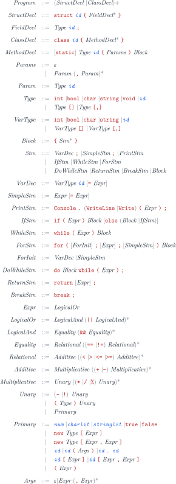

# csharp-x86-compi

`csharp-x86-compi` es un compilador en C++17 para un subconjunto pequeño de C#.
Lee archivos `.cs`, los valida con un lexer, un parser y un type checker, y
genera ensamblador x86-64 en sintaxis GNU/AT&T.

El ensamblador generado está orientado a Linux ELF (`printf@PLT`, `-no-pie`).
Esto significa que el compilador se puede construir en Linux o macOS, pero los
programas generados se ejecutan de forma nativa solo en Linux. En macOS se usa
Docker para ensamblar y ejecutar dentro de un contenedor Linux.

## Características

- Parser descendente recursivo para un subconjunto documentado de C#.
- Verificación semántica con tablas de símbolos y alcances anidados.
- Generación de código x86-64 GNU/AT&T.
- Optimizaciones opcionales activadas por defecto:
  - plegado de constantes
  - numeración de Sethi-Ullman
  - optimización peephole textual
- Suite de pruebas para programas válidos y errores esperados del compilador.

## Estructura del repositorio

```text
include/         Headers del compilador
src/             Implementación en C++17
inputs/          Programas .cs válidos e inválidos de ejemplo
tests/expected/  Salidas esperadas versionadas para programas válidos
scripts/         Utilidades de Docker, pruebas y salidas esperadas
outputs/         Ensamblador y binarios generados, ignorados por git
build/           Binario nativo del compilador, ignorado por git
.docker-build/   Binario Linux usado por scripts/docker.sh, ignorado por git
```

## Requisitos

Linux:

```bash
sudo apt-get update
sudo apt-get install -y build-essential make
```

macOS:

```bash
xcode-select --install
```

Docker es necesario en macOS para ejecutar programas generados y correr la suite
completa de pruebas. Instala Docker Desktop y verifica que esté disponible:

```bash
docker --version
```

## Construir el compilador

Linux y macOS:

```bash
make
```

El comando genera:

```text
build/compiler
```

En macOS, este binario puede convertir archivos `.cs` en archivos `.s`, pero el
ensamblador generado necesita Linux o Docker para ejecutarse.

## Generar ensamblador desde un archivo

Linux y macOS:

```bash
./build/compiler inputs/07_cast.cs
```

El comando genera:

```text
outputs/07_cast.s
```

Opciones útiles del compilador:

```bash
./build/compiler inputs/07_cast.cs --opt
./build/compiler inputs/07_cast.cs --no-opt
./build/compiler inputs/07_cast.cs --tokens --ast
./build/compiler inputs/07_cast.cs -o outputs/custom_name.s
```

`--opt` es el modo por defecto.

## Ejecutar un programa generado

Linux:

```bash
./build/compiler inputs/07_cast.cs
g++ -no-pie outputs/07_cast.s -o outputs/07_cast
./outputs/07_cast
```

macOS:

```bash
scripts/docker.sh run inputs/07_cast.cs
```

El comando de macOS reconstruye el compilador dentro de un contenedor Linux,
genera el ensamblador, lo enlaza con `g++ -no-pie` y ejecuta el programa.

## Ejecutar todos los programas válidos de ejemplo

Linux:

```bash
make compile-all
for s in outputs/*.s; do
  b="${s%.s}"
  g++ -no-pie "$s" -o "$b"
  "$b"
done
```

macOS:

```bash
make run-all
```

`make run-all` usa Docker para ensamblar y ejecutar el código Linux generado.
Omite `inputs/err_*.cs` porque esos archivos son fallos esperados del
compilador.

## Correr la suite de pruebas

Linux:

```bash
make test
```

macOS:

```bash
scripts/docker.sh test
```

La suite revisa todos los archivos en `inputs/`:

- Los programas válidos se compilan con `--opt` y `--no-opt`.
- Ambos modos deben producir la misma salida en ejecución.
- La salida se compara con `tests/expected/<name>.txt`.
- Los programas inválidos llamados `err_*.cs` deben fallar en la fase esperada:
  léxica, sintáctica o semántica.

## Regenerar salidas esperadas

Regenera las salidas esperadas solo cuando el cambio de comportamiento sea
intencional.

Linux:

```bash
bash scripts/gen_expected.sh
git diff tests/expected
```

macOS:

```bash
scripts/docker.sh gen
git diff tests/expected
```

Revisa el diff antes de hacer commit de archivos modificados en
`tests/expected/`.

## Limpiar archivos generados

Linux:

```bash
make clean
```

macOS:

```bash
make clean
rm -rf .docker-build
```

`make clean` elimina `build/` y `outputs/`. El comando adicional de macOS elimina
el binario Linux producido por el helper de Docker.

## Gramática

<p align="center">
  
</p>
